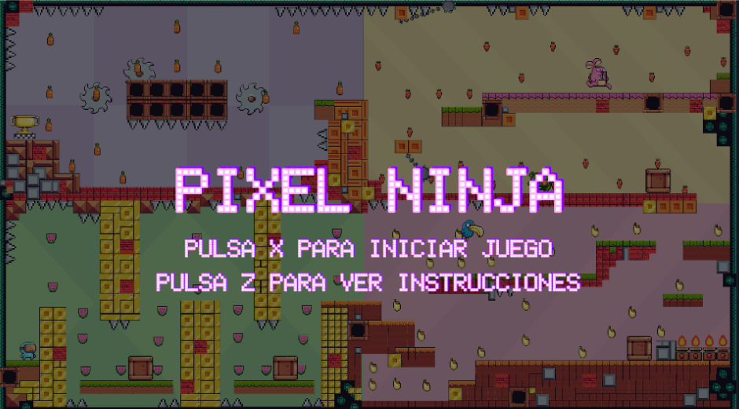

# 🎮 Pixel Ninja - Juego en Unity 2D

## 🛠 Motor y Plataforma
- **Motor:** Unity **2022.3.43f1** 🚀 (Versión específica utilizada para el desarrollo).
- **Plataforma:** PC 💻

---

## 🎯 Mecánicas Principales

### 🏃 Movimiento del Jugador
- Puede **correr** hacia adelante o atrás.
- Puede **saltar** para esquivar obstáculos.

### 🏆 Interacciones con el Entorno
- Recoge objetos como **trofeos de victoria** y **frutas** 🍎🍌 en las cuatro etapas.
- Puede **mover cajas** 📦 para superar obstáculos.

### 👾 Sistema de Enemigos
- Los enemigos tienen un área de movimiento definida.
- Se desplazan **horizontalmente**, caminando o volando de un lado a otro.
- Cambian la dirección de su rostro según su movimiento.
- Si el jugador **colisiona** con un enemigo, **pierde** ❌.

### 📈 Progresión
- **4 niveles** con diferentes temáticas y obstáculos.
- En el último nivel, el jugador debe recoger **la copa** 🏆 para ganar.

### 🎨 Estilo Visual
- **Pixel Art Kawaii/Cute** 🌸 con predominancia de colores **pastel**.
- A pesar de su apariencia amigable, el juego incluye **trampas hostiles** como:
  - **Púas** ⚔️
  - **Mazas giratorias** 🔩
  - **Fuego** 🔥
  - **Sierras** ⚙️

---

## 📋 Paneles del Juego

- **📜 Menú Principal:** Muestra el nombre del juego con opciones para ver las instrucciones o iniciar.
- **📖 Instrucciones:** Explicación breve sobre los controles y mecánicas.
- **🏅 You Win:** Aparece cuando el jugador gana, con opciones para reiniciar o salir.
- **❌ Game Over:** Se muestra cuando el jugador pierde, permitiendo reiniciar o salir.
- **🔚 Fin:** Indica el final del juego si el jugador selecciona **salir**.

---

## 🕹️ Instrucciones de Uso

### ✅ Requisitos Previos
- Instala **Unity 2022.3.43f1** para evitar problemas de compatibilidad.

### 📂 Abrir el Proyecto
1. Descarga el proyecto.
2. Abre **Unity**.
3. Haz clic en **"Add"** ➝ **"Add project from disk"**.
4. Selecciona el archivo descargado del repositorio.

### ▶️ Ejecutar el Juego
1. En la parte superior de Unity, haz clic en el **botón de "Play"** ▶️.
2. Sigue las instrucciones dentro del juego.

---

## 🔗 Video Demostrativo
📽️ Mira el funcionamiento del juego aquí: [YouTube](https://www.youtube.com/watch?v=KPqFYElM3qQ)

## 📷 Vista Previa 

